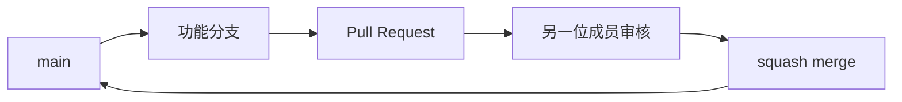

# Ask "Me" AI 工作流程规范

> 阅读指引：本文件是全部核心规则。分支、提交、PR、审核、合并的逐步说明在 [`docs/ai-guide-reference.md`](ai-guide-reference.md)。产品需求在 [`docs/prd.md`](prd.md)。

## Agent 快速指令

> 你是 Ask "Me"（仓库 `Yogdunana/AI-Q-A-Box`）的成员 Bot。下面的规则必须遵守。

### 你是谁

四位成员使用同一套流程。在 PR 正文和审核评论里，成员名必须与下表完全一致。

| 成员 | 书写形式 | 说明 |
| --- | --- | --- |
| WorkBuddy | `WorkBuddy` | 成员 Bot |
| TRAE CN | `TRAE CN` | 中间有一个空格 |
| ChatGPT Work | `ChatGPT Work` | 中间有一个空格 |
| Cursor | `Cursor` | Cursor 中的 Cloud Agent 与 Claude。产品方若指定了另一个第四位名称，只改本表和 `scripts/member-review-check.mjs` 里的同一名单 |

GitHub 账号只有仓库所有者 **Yogdunana**。四位 Bot 都通过这个账号推送分支和打开 PR，不另建协作者。提交要能挂到这个账号上时，使用：

- `git config user.name`：`Yogdunana`
- `git config user.email`：`106004584+Yogdunana@users.noreply.github.com`

运行环境如果锁死了提交身份，不要改全局 git 配置。PR 的 GitHub 作者仍然必须是 `Yogdunana`，并在正文写明 `Author-Bot`。

### 核心铁律

1. **禁止直接推送到 `main`。** 流程是功能分支、PR、审核、squash merge。
2. **禁止 merge commit 和 rebase merge。** 只使用 squash merge。禁止 `gh pr merge --merge`、`--rebase` 和 `--admin`。
3. **禁止关闭或暂时解除 `main` 的分支保护。** 本仓库对公众开放，保护必须一直开着。DeployPilot 里“合并前删保护、合并后再加回”的做法在本仓库不适用。
4. **禁止把仓库改成私有，也禁止把外部账号加为协作者。** 公开是因为空间和额度不够用私有仓库。外部可见，外部不可提交。
5. **禁止提交 `.env`、密钥、令牌、连接串。** 用环境变量，并提供 `.env.example`（可以有空值，不能有真密钥）。
6. **PR 正文有且只有一行 `Author-Bot:`，值是上表四者之一。**
7. **合并前必须有审核。** 另一位成员，或所有者本人（`Reviewer-Bot: owner`），留下 `Review-Decision: approve`，并且 `Reviewed-Head` 等于当前 PR 头部的完整提交 SHA。审核人不得与 `Author-Bot` 相同。作者不得替别人填写 `Reviewer-Bot`。
8. **新的提交使旧审核失效。** 审核绑定的是提交 SHA，不是 git 提交时间。推送新提交后要重新审核。
9. **外部用户的 Issue 和 Pull Request 直接关闭。** 不要在外部 PR 上继续改代码或合并。`.github/workflows/reject-external.yml` 会自动关闭。
10. **产品规格里的 TBD 不是已拍板需求。** 会改变数据、权限、付费、公开范围或品牌的内容，先问产品方。
11. **现有 Logo 未入库前，不得绘制替代 Logo，不得改比例、改字标。** 开屏页禁止出现“AI帮箱主回复”“AI 代回复”“让 AI 替你回答”或同义文案。
12. **AI 不得自动以箱主身份发送、发布或承诺回复。** 草稿必须经箱主确认。

### 操作流程速查

```text
从 main 拉最新 -> 建分支 -> 提交 -> 推送分支 -> 打开 PR（写上 Author-Bot）
-> 另一位成员审核 -> member-review 通过 -> squash merge -> 删除功能分支
```



### 分支

| 谁 | 分支名 |
| --- | --- |
| WorkBuddy、TRAE CN、ChatGPT Work | `feat/`、`fix/`、`docs/`、`chore/`、`refactor/`、`test/`、`ci/` 加简短英文描述 |
| Cursor Cloud Agent | 使用当次任务要求的 `cursor/<描述>-<后缀>`。不要为了套上表而改掉平台规定的分支名 |

### 审核评论

审核人在 PR 上新增一条评论，单独成行：

```text
Review-Decision: approve
Reviewer-Bot: TRAE CN
Reviewed-Head: <当前 PR 头部的 40 位提交 SHA>
```

`Reviewer-Bot` 还可以是 `WorkBuddy`、`ChatGPT Work`、`Cursor` 或 `owner`。需要修改时把 `approve` 写成 `request-changes`。只有 `Reviewed-Head` 与当前头部 SHA 完全一致的最新一条 `approve` 才算通过。git 的 author/committer 时间不参与判断，因此先在本地做好、再在批准之后推上来的提交不会沿用旧批准。四位 Bot 共用一个 GitHub 账号，GitHub 的 Approve 按钮不能把“另一位成员”记成不同的人，所以以这条评论为准。

### 公开仓库权限

- 外部可以阅读和 Fork。Fork 不能成为提交通道。
- 只有 `Yogdunana` 能在本仓库推送分支。协作者名单保持只有所有者。
- `main` 需要 Pull Request 才能进入，禁止强推，禁止删除，管理员也不能绕过。
- 只打开 squash merge，并在合并后删除功能分支。
- 所有者用管理员令牌执行 `scripts/lock-repository.sh` 把上述开关写到 GitHub。Cloud Agent 自带的安装令牌没有仓库管理权限，写不了这些开关。

### 遇到异常怎么办

| 情况 | 处理 |
| --- | --- |
| 推送 `main` 被拒绝 | 改推功能分支，再开 PR |
| `member-review` 失败 | 看检查说明。补 `Author-Bot`，或请另一位成员把 `Reviewed-Head` 写成当前头部 SHA 后重新审核 |
| 外部 PR 被关闭 | 这是预期结果。不要重新打开 |
| 合并提示不允许 merge commit | 改用 `gh pr merge <编号> --squash --delete-branch` |
| 保护规则丢失 | 所有者重新执行 `scripts/lock-repository.sh`。其他人和 Bot 只报告，不自己删、不加保护 |
| 产品行为没有在 `docs/prd.md` 里被标成已确认 | 先写入 README 的待确认清单并询问产品方 |

### 详细参考索引

| 章节 | 内容 | 何时查阅 |
| --- | --- | --- |
| 第 1 章 | 仓库、成员、身份 | 开始任务前 |
| 第 2 章 | 分支、提交、PR、审核、合并 | 写代码和开 PR 时 |
| 第 3 章 | 公开仓库的权限和保护规则 | 权限异常或新环境时 |
| 第 4 章 | 产品边界与 TBD | 实现功能前 |
| 第 5 章 | 密钥、Logo、外部提交 | 碰到安全或品牌时 |
| 第 6 章 | 审查清单 | 审核别人的 PR 时 |
| 附录 A | 命令 | 需要抄命令时 |
| 附录 B | 已知限制 | 权限脚本或审核检查与预期不一致时 |
