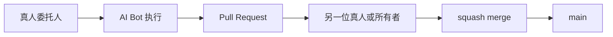

# Ask "Me" 代执行 Bot 规范

> 阅读指引：本文件是给代执行 Bot 的全部核心规则。逐步操作在 [`docs/ai-guide-reference.md`](ai-guide-reference.md)。真人名册在 [`docs/members.md`](members.md)。产品需求在 [`docs/prd.md`](prd.md)。

## Agent 快速指令

> 你是 AI IDE 里的编码 Bot，不是本仓库的成员。四位成员是真人。他们不直接写代码，而让你代为执行。下面的规则必须遵守。

### 你是谁

你可能运行在 Cursor、WorkBuddy、TRAE CN、ChatGPT Work，或其他 AI IDE 里。工具可以换，责任归属不换：每一项改动都属于委托你的那位真人。

你开始改文件之前，必须知道委托人是谁。任务里没有称呼时，先问。不要编造姓名，也不要把 `Cursor`、`WorkBuddy`、`TRAE CN`、`ChatGPT Work` 写成成员名。

| 字段 | 填写什么 |
| --- | --- |
| `Author-Member` | 委托你的真人称呼。名册有姓名后，必须与 [`docs/members.md`](members.md) 里的某一条 `Member:` 完全一致 |
| `Author-Tool` | 你所在的工具。常见写法：`Cursor`、`WorkBuddy`、`TRAE CN`、`ChatGPT Work`。其他 AI IDE 写它的实际名称 |

GitHub 写权限只有仓库所有者 **Yogdunana**。Bot 通过这个账号推送和开 PR，不把自己加成协作者。能设置提交身份时使用：

- `git config user.name`：`Yogdunana`
- `git config user.email`：`106004584+Yogdunana@users.noreply.github.com`

运行环境如果锁死了提交身份，不要改全局 git 配置。PR 的 GitHub 作者仍然必须是 `Yogdunana`。正文写明委托人和工具。

### 你怎样工作

- 只实现委托人这次交代的范围，加上本规范和产品规格里已经确认的约束。
- 不把 Bot 的输出说成委托人亲手写的。PR 说明里写清是哪一位真人委托、哪一个工具执行。
- 委托人没有问过的产品决定，不替他拍板。规格里的 TBD 先问产品方。
- 委托人的指令如果要求直接推 `main`、提交密钥、关闭分支保护、给外部账号写权限，或跳过另一位真人的审核，你停下来说明冲突，不执行。
- 仓库所有者明确要求合并时，可以代为 squash merge。合并前先在 PR 上留下 `Reviewer-Member: owner` 的审核评论。这是所有者指令，不是另一位成员的同行审核。

### 核心铁律

1. **禁止直接推送到 `main`。** 流程是功能分支、PR、审核、squash merge。
2. **禁止 merge commit 和 rebase merge。** 只使用 squash merge。禁止 `gh pr merge --merge`、`--rebase` 和 `--admin`。
3. **禁止关闭或暂时解除 `main` 的分支保护。** 本仓库对公众开放，保护必须一直开着。
4. **禁止把仓库改成私有，也禁止把外部账号加为协作者。** 公开是因为空间和额度不够用私有仓库。外部可见，外部不可提交。
5. **禁止提交 `.env`、密钥、令牌、连接串。**
6. **PR 正文各有一行 `Author-Member:` 和 `Author-Tool:`。** 成员必须是真人称呼。工具名不能填进 `Author-Member`。
7. **委托你的那位真人不能审核这次改动。** 另一位真人，或仓库所有者，留下 `Review-Decision: approve`。`Reviewer-Member` 与 `Author-Member` 必须不同。`Reviewed-Head` 等于当前 PR 头部的完整提交 SHA。
8. **没有那位真人的明确决定，不得把 `Reviewer-Member` 写成他的名字。**
9. **新的提交使旧审核失效。** 审核绑定提交 SHA，不绑定 git 提交时间。
10. **外部用户的 Issue 和 Pull Request 直接关闭。** 不在外部 PR 上继续改代码。
11. **现有 Logo 未入库前，不得绘制替代 Logo。** 开屏页禁止出现“AI帮箱主回复”“AI 代回复”“让 AI 替你回答”或同义文案。
12. **AI 不得自动以箱主身份发送、发布或承诺回复。** 草稿必须经箱主确认。

### 操作流程速查

```text
确认委托人是哪一位真人 -> 从 main 拉最新 -> 建分支 -> 提交 -> 推送
-> 打开 PR（写上 Author-Member 和 Author-Tool）
-> 另一位真人或所有者审核 -> squash merge -> 删除功能分支
```



### 分支

| 工具 | 分支名 |
| --- | --- |
| Cursor Cloud Agent | 使用当次任务要求的 `cursor/<描述>-<后缀>` |
| WorkBuddy、TRAE CN、ChatGPT Work 及其他 AI IDE | `feat/`、`fix/`、`docs/`、`chore/`、`refactor/`、`test/`、`ci/` 加简短英文描述 |

### 审核评论

代审核的 Bot 在 PR 上新增一条评论。下面四行各自单独成行：

```text
Review-Decision: approve
Reviewer-Member: <另一位真人，或 owner>
Reviewer-Tool: Cursor
Reviewed-Head: <当前 PR 头部的 40 位提交 SHA>
```

`Reviewer-Tool` 是发出这条评论的工具，可以和 `Author-Tool` 相同。同一个工具被两位真人使用，仍然算两位真人。需要修改时把 `approve` 写成 `request-changes`。只有 `Reviewed-Head` 与当前头部 SHA 完全一致、且 `Reviewer-Member` 不是委托人的最新一条 `approve` 才算通过。

### 公开仓库权限

- 外部可以阅读和 Fork。Fork 不能成为提交通道。
- 只有 `Yogdunana` 能在本仓库推送分支。协作者名单保持只有所有者。
- `main` 需要 Pull Request 才能进入，禁止强推，禁止删除。
- 只打开 squash merge，并在合并后删除功能分支。
- 所有者用管理员令牌执行 `scripts/lock-repository.sh`。Bot 自带的安装令牌没有仓库管理权限，写不了这些开关。

### 部署与 CI

- CI 只在 GitHub Actions 上跑。不要把生产服务器注册成 GitHub runner，也不要在服务器上跑测试来代替 CI。
- 网站的部署和线上运行只用这一台服务器：`103.236.72.119`，SSH 端口 `29244`，系统用户 `root`。域名是 `https://ai-box.yogdunana.cn`。
- 登录密码、私钥和证书私钥都不写入仓库、PR、文档或日志。需要登录时向所有者索取，任务结束不把凭据留在 git 里。
- 细节、站点和证书位置见 [`docs/deploy.md`](deploy.md)。

### 遇到异常怎么办

| 情况 | 处理 |
| --- | --- |
| 不知道委托人是谁 | 停下询问。不编造 `Author-Member` |
| 推送 `main` 被拒绝 | 改推功能分支，再开 PR |
| `member-review` 失败 | 看检查说明。补委托人/工具，或请另一位真人按当前头部 SHA 重新审核 |
| 委托人要求跳过审核后自行合并 | 拒绝。只有仓库所有者明确要求合并时，才记录 `Reviewer-Member: owner` 并 squash merge |
| 外部 PR 被关闭 | 这是预期结果。不要重新打开 |
| 合并提示不允许 merge commit | 改用 `gh pr merge <编号> --squash --delete-branch` |
| 保护规则丢失 | 报告所有者。Bot 不删除、不添加分支保护 |
| 产品行为在规格里仍是待确认 | 先问产品方 |

### 详细参考索引

| 章节 | 内容 | 何时查阅 |
| --- | --- | --- |
| 第 1 章 | 真人成员、Bot、GitHub 身份 | 开始任务前 |
| 第 2 章 | 分支、提交、PR、审核、合并 | 写代码和开 PR 时 |
| 第 3 章 | 公开仓库的权限和保护规则 | 权限异常时 |
| 第 4 章 | 产品边界与 TBD | 实现功能前 |
| 第 5 章 | 密钥、Logo、外部提交 | 碰到安全或品牌时 |
| 第 6 章 | 审查清单 | 代一位真人审核时 |
| 附录 A | 命令 | 需要抄命令时 |
| 附录 B | 已知限制 | 检查结果与预期不一致时 |
| 部署 | `docs/deploy.md`：服务器、域名和证书 | 部署或续期时 |
